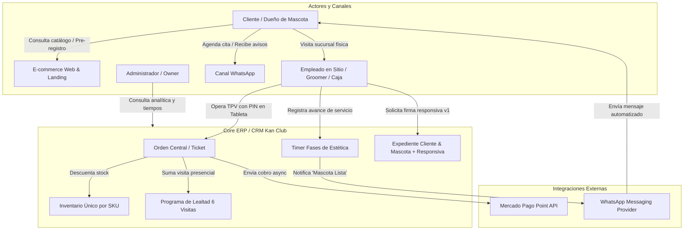
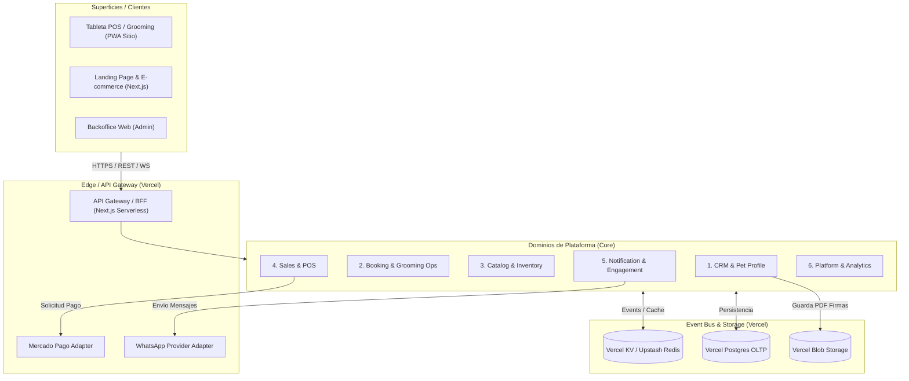
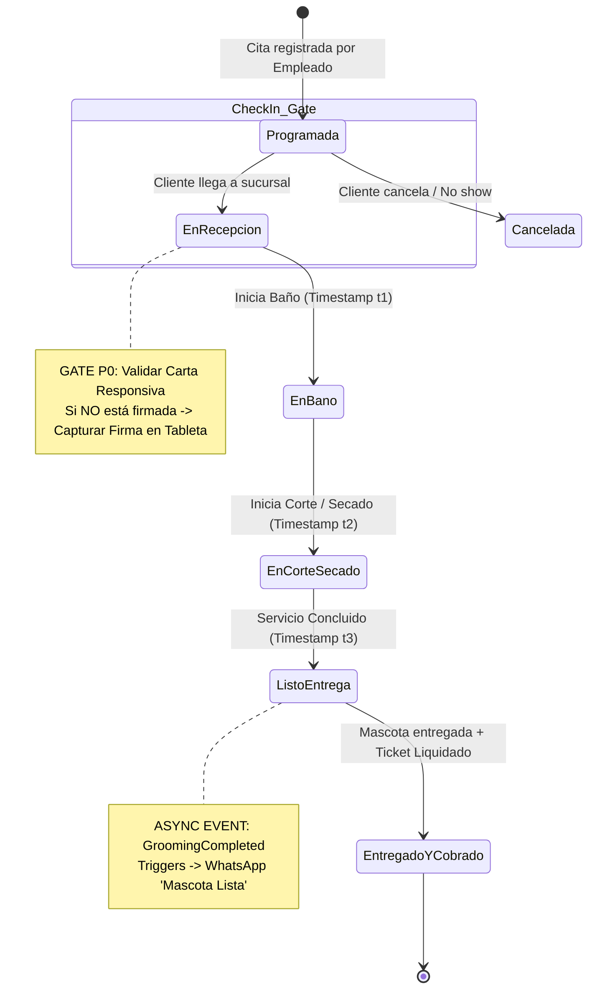
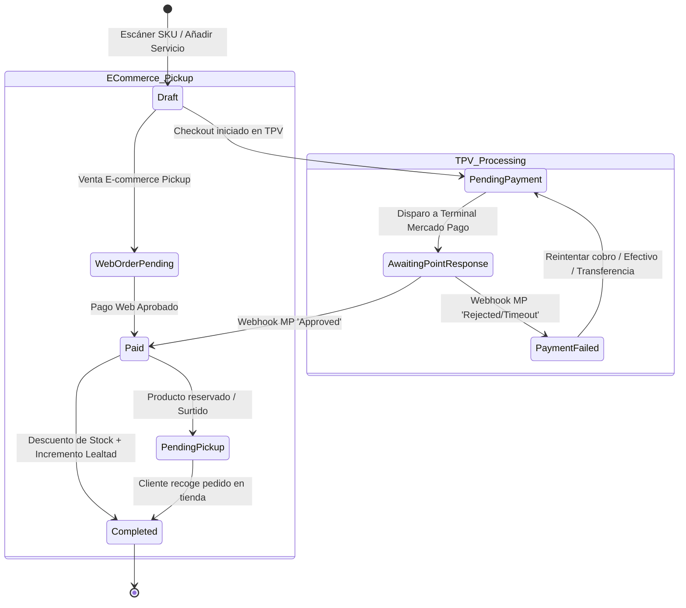
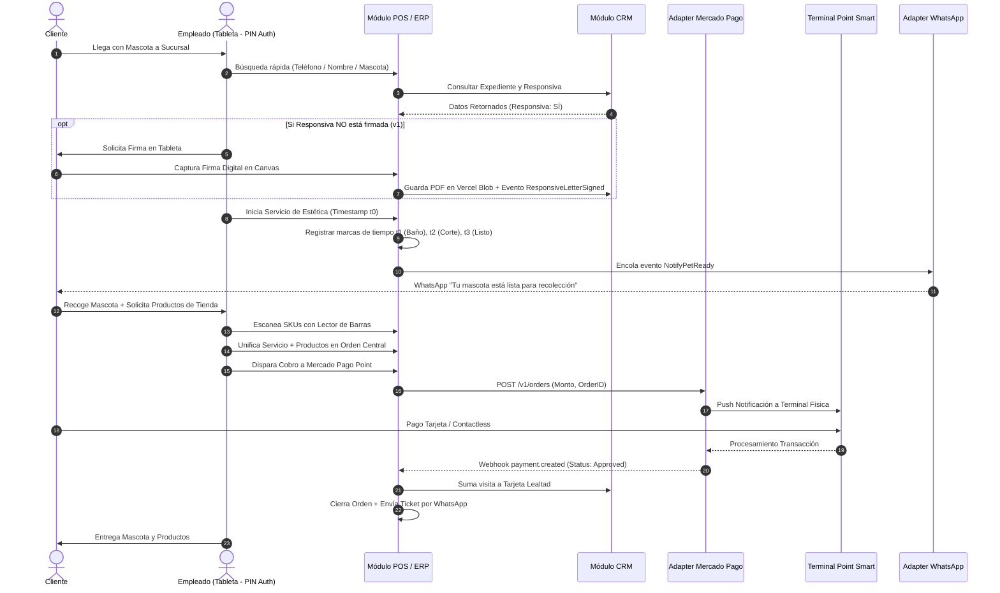
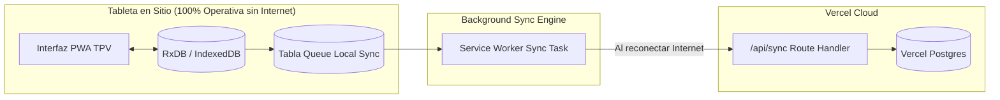

# kan_club_architecture.md — Especificación de Arquitectura de Plataforma Digital (ERP + CRM Omnicanal)

**Versión:** 1.0.0  
**Fecha:** 30 de Octubre, 2026  
**Estado:** Congelado / Listo para Construcción (Handoff to Build)  
**Stack Baseline:** Vercel Fullstack Serverless (Next.js App Router, Vercel Postgres, Vercel KV Redis, Vercel Blob)

---

## 0. Brief del Producto & Restricciones (MVP)

**Kan Club** es un sistema integral de gestión operativa (ERP + CRM Omnicanal) diseñado para una estética canina y pet shop física (1 sucursal) con tienda en línea sincronizada en tiempo real bajo la modalidad de recolección en tienda (**100% Click & Collect / Pickup**).

### Alcance del MVP
* **Punto de Venta (TPV) & Operación en Sitio:** Gestión unificada de clientes, perfiles de mascotas, agenda de citas, cobro unificado en caja (servicios de grooming + productos escaneados por SKU) mediante integración directa por API/Webhook con terminal Mercado Pago Point Smart.
* **Compliance Legal (Carta Responsiva):** Firma digital de carta responsiva en tableta, requerida obligatoriamente una sola vez por cliente durante su primera visita.
* **E-commerce & Landing Page:** Catálogo web de productos para compra con recolección en sucursal, cotizador interactivo de servicios con redirección a WhatsApp para agendamiento, y portal "Mi Mascota" con autenticación mediante WhatsApp OTP.
* **Fases de Estética & Timestamps:** Control de avance del servicio de grooming (Recepción → Baño → Corte/Secado → Listo) con registro de marcas de tiempo (*timestamps*) y envío de notificación automática por WhatsApp ("Mascota Lista").
* **Resiliencia Operativa (Offline-First):** PWA instalable en tableta con base de datos local (IndexedDB / RxDB) para garantizar ventas en efectivo, registro de firmas y timers sin interrupción por fallas de internet.
* **Infraestructura Cloud:** Despliegue 100% Serverless en la nube de Vercel.

### No-Objetivos del MVP
1. **Multi-sucursal / Franquicias:** El sistema opera bajo el modelo de 1 sola tienda física + 1 e-commerce.
2. **Facturación Electrónica Automática (CFDI 4.0):** Facturación manual a solicitud; la caja opera con corte diario global a público en general.
3. **App Móvil Nativa (iOS/Android):** Reemplazada por PWA táctil para tableta y web responsive para clientes.
4. **Envíos a Domicilio / Logística Externa:** Compras en línea limitadas a recolección en tienda (Pickup).
5. **Bot IA Interactivo Inbound:** WhatsApp es 100% saliente (*outbound*) para avisos automáticos; las respuestas son atendidas manualmente por personal.

---

## 1. Clarification Log Completo (CL-001 a CL-027)

| ID | Fecha | Módulo | Pregunta / Conflicto | Impacta a | Severidad | Decisión | Dueño | Estado |
|---|---|---|---|---|---|---|---|---|
| CL-001 | 28/10/2026 | General | Modelo de negocio e industria | Todos | P0 | Kan Club: Estética canina física (1 sucursal) + E-commerce + ERP/CRM. | Cliente | CERRADO |
| CL-002 | 28/10/2026 | Actores | Usuarios pagadores y operadores | Auth / RBAC | P0 | Clientes pagan servicios/productos. Operación física en sitio en tableta/POS por empleados. | Cliente | CERRADO |
| CL-003 | 28/10/2026 | Regulación | Normativa aplicable | Compliance | P0 | México. Firma de carta responsiva digital en sitio. | Cliente | CERRADO |
| CL-004 | 28/10/2026 | Alcance MVP | Gestión omnicanal e inventarios | ERP / CRM | P0 | Clientes, mascotas, agenda, inventario por SKU, lealtad, TPV y recordatorios. | Cliente | CERRADO |
| CL-005 | 28/10/2026 | Integraciones | Vendors autorizados | Hardware / Vendors | P0 | Mercado Pago Point, WhatsApp API, escáner de código de barras, tableta. | Cliente | CERRADO |
| CL-006 | 28/10/2026 | TPV / Caja | Unificación de ticket | TPV / Inventario | P0 | Ticket único combina servicios de estética e ítems físicos por SKU. | Cliente | CERRADO |
| CL-007 | 28/10/2026 | Integraciones | Automatización cobro Mercado Pago | TPV / Payments | P0 | Cobro integrado por API/Webhook de Mercado Pago Point. | Cliente | CERRADO |
| CL-008 | 28/10/2026 | Operación | Gate de Firma de Carta Responsiva | Grooming / Compliance | P0 | Infranqueable pero 1 sola vez por cliente (se valida en expediente). | Cliente | CERRADO |
| CL-009 | 28/10/2026 | CRM | Programa de lealtad | CRM / TPV | P1 | Tarjeta presencial 6 visitas: 3ª (20% desc. premios), 4ª (premio gratis), 6ª (50% desc. estética). | Cliente | CERRADO |
| CL-010 | 28/10/2026 | Agenda | Política de reservación | Booking | P1 | No requiere anticipo para reservar cita. | Cliente | CERRADO |
| CL-011 | 28/10/2026 | Operación | Medición de tiempos | Analytics / Ops | P1 | Registro de timestamps por fase de servicio (Recepción → Baño → Corte → Listo). | Cliente | CERRADO |
| CL-012 | 28/10/2026 | Inventario | Concurrencia presencial vs web | Inventory / POS | P0 | Prioridad a la TPV presencial. Venta web sin stock activa Backorder/Surtido interno. | Cliente | CERRADO |
| CL-013 | 28/10/2026 | Booking | Agendamiento en web | Booking Ops | P0 | Agenda gestionada 100% por empleados en sitio. Web redirige a WhatsApp. | Cliente | CERRADO |
| CL-014 | 28/10/2026 | Notificaciones | Canal de respuesta WhatsApp | WhatsApp Adapter | P1 | Canal 100% saliente (outbound) para avisos automáticos. | Cliente | CERRADO |
| CL-015 | 28/10/2026 | TPV / Caja | Fallo de cobro Mercado Pago Point | POS / Payments | P0 | Fallback inmediato a métodos alternativos (Efectivo, Transferencia). | Cliente | CERRADO |
| CL-016 | 28/10/2026 | Grooming Ops | Flexibilidad de ciclo de vida | Booking / POS | P0 | Fases no bloqueantes estrictas (permite cobro anticipado o saltos de fase). | Cliente | CERRADO |
| CL-017 | 28/10/2026 | Analytics | Timers sin restricción | Grooming Ops | P1 | Captura data de tiempo sin imponer bloqueos ni alertas punitivas. | Cliente | CERRADO |
| CL-018 | 28/10/2026 | Arquitectura | Operatividad Offline | TPV / Edge Sync | P0 | App Tableta Offline-First con IndexedDB (RxDB) para operar sin internet. | Cliente | CERRADO |
| CL-019 | 28/10/2026 | CRM | Triggers de recompra y campañas | CRM / Notification | P1 | Automatización por días desde compra + campañas a clientes inactivos. | Cliente | CERRADO |
| CL-020 | 28/10/2026 | RBAC | Rol por hardware único (1 tableta) | RBAC / POS | P0 | Unificación de permisos en perfil de Empleado (Atención, Timers, TPV). | Cliente | CERRADO |
| CL-021 | 28/10/2026 | Stack | Hospedaje e Integraciones | Deploy / Stack | P0 | Despliegue 100% Vercel (Next.js + Vercel Postgres + Vercel KV + Vercel Blob). | Cliente | CERRADO |
| CL-022 | 28/10/2026 | Auth | Acceso a Tableta TPV | Auth / Audit | P1 | Login por PIN de 4 dígitos para auditoría de acciones (`employee_id`). | Cliente | CERRADO |
| CL-023 | 28/10/2026 | E-commerce | Modalidad de entrega | E-com / Checkout | P0 | Compras online operan 100% bajo modalidad Pickup en Sucursal. | Cliente | CERRADO |
| CL-024 | 28/10/2026 | Landing | Foco de la Landing Page | Web / CRM | P0 | Enfocada en E-commerce (Pickup) con CTA secundario a WhatsApp. | Cliente | CERRADO |
| CL-025 | 28/10/2026 | CRM / Auth | Búsqueda e identificación de clientes | CRM / Web | P0 | Portal Web vía WhatsApp OTP. Búsqueda rápida en TPV por Teléfono/Nombre/Mascota. | Cliente | CERRADO |
| CL-026 | 28/10/2026 | E-commerce | Cotizador de Servicios Web | Web / Services | P1 | Cotizador interactivo por tamaño/raza para estimaciones transparentes. | Cliente | CERRADO |
| CL-027 | 28/10/2026 | CRM | Pre-registro de clientes en Web | CRM / Web | P1 | Permite a clientes nuevos dar de alta a sus mascotas desde la web. | Cliente | CERRADO |

---

## 2. Estructura de Negocio & Dominios de Plataforma

### 2.1 Modelo Mental
> **Cliente + Mascota → Pre-registro / Walk-in → Gate Responsiva (v1) → Fases Grooming (timestamps) + Carrito SKUs → Cobro Unificado TPV (Mercado Pago API) → Actualización Lealtad e Inventario**

### 2.2 Matriz de Roles y Visibilidad (RBAC)

| Actor | Rol | Qué decide | Qué ve | Qué no ve |
|---|---|---|---|---|
| **Cliente** | Consumidor | Agendar citas (vía WhatsApp), comprar productos en línea (Pickup), firmar carta responsiva digital. | Catálogo web, sus citas, historial de mascota, saldo de lealtad, carta responsiva firmada. | Costos de proveedor, márgenes de utilidad, agenda interna de otros clientes, flujo de caja. |
| **Empleado / Groomer** | Operador TPV y Grooming | Registrar entradas, cambiar fases de baño/corte, procesar cobro en TPV, escanear SKUs. | Agenda del día, catálogo TPV, timers de servicio, firmas pendientes, módulo de cobro. | Reportes de utilidad global, configuraciones del sistema, credenciales de pago. |
| **Administrador** | Superusuario / Owner | Precios, altas de inventario/SKU, promociones, reglas de lealtad, gestión de personal. | Todo el sistema: Analítica de tiempos de servicio, cortes de caja, inventario global, CRM completo. | N/A (Acceso total). |

### 2.3 Diagrama de Relaciones Comerciales y Actores



### 2.4 Arquitectura de Dominios de Plataforma



#### Responsabilidades de los Dominios:
1. **CRM & Pet Profile Domain:** Registro de clientes, perfiles de mascotas, expediente médico/estético, firma responsiva digital (Vercel Blob) y tarjeta de lealtad de 6 visitas.
2. **Booking & Grooming Ops Domain:** Control de agenda de citas, gestión de turnos, fases del servicio de estética y captura de marcas de tiempo (*timestamps*).
3. **Catalog & Inventory Domain:** Catálogo unificado de SKUs y servicios, control de stock físico en tiempo real con prioridad para la venta en TPV presencial.
4. **Sales & POS Domain:** Carrito omnicanal (combina servicios + productos físicamente escaneados), cierres de caja (*cortes de caja*) y orquestación de pago en TPV.
5. **Notification & Engagement Domain:** Envíos automatizados de WhatsApp saliente (*outbound*) para avisos de "Mascota Lista", recordatorios de recompra y campañas promocionales.
6. **Platform & Analytics Domain:** Autenticación (PIN de 4 dígitos para empleados, WhatsApp OTP para clientes), auditoría de eventos y tableros analíticos de métricas operativas.

---

## 3. Ciclo de Vida & Flujos Operativos

### 3.1 Máquina de Estados: Servicio de Estética (`GroomingService`)



### 3.2 Máquina de Estados: Orden / Ticket Unificado (`Order`)



### 3.3 Secuencia Detallada de Atención y Cobro en TPV



---

## 4. Especificación de Landing Page & E-commerce (Pickup)

### 4.1 Estructura de Secciones (UX/UI First)

1. **Hero Section:** Estética premium y cálida. Mensaje de marca: *"El club donde tu mejor amigo se siente como en casa"*. CTAs principales: **\[Comprar en Línea (Pickup)\]** y **\[Agendar por WhatsApp\]**. Badge con estatus de tienda abierta y horarios.
2. **Cotizador Interactivo de Estética:** Selector rápido por tamaño (*Chico / Mediano / Grande / Gigante*) y tipo de pelo. Despliega un costo estimado transparente y duración sugerida con botón directo: *"Agendar cita por WhatsApp"* (abre chat con mensaje pre-llenado con raza/tamaño).
3. **Catálogo E-commerce (Click & Collect):** Filtros por categorías (*Alimento Premium, Premios Naturales, Accesorios, Cuidados & Higiene*). Muestra indicador de stock disponible en tiempo real y checkout optimizado exclusivamente para **Recolección en Tienda**.
4. **Explicación del Club de Lealtad:** Muestra gráfica de la tarjeta presencial de 6 visitas (3ª visita: 20% en premios naturales, 4ª visita: premio gratis, 6ª visita: 50% en baño/corte).
5. **Portal "Mi Mascota & Compras":** Login sin contraseña mediante código OTP recibido por WhatsApp. El cliente puede consultar la ficha de sus mascotas, cartas responsivas firmadas, compras previas y visitas acumuladas en su tarjeta de lealtad.

---

## 5. Arquitectura Técnica & Stack en Vercel

### 5.1 Stack Tecnológico Definitivo

| Capa | Tecnología Seleccionada | Justificación / Rol en el Sistema |
|---|---|---|
| **Frontend (Tableta & Web)** | Next.js 14+ (App Router) + React + Tailwind CSS | Framework unificado en Vercel. PWA instalable para la tableta en sitio. |
| **Local DB (Tableta)** | RxDB / Dexie.js (IndexedDB) | Motor reactivo local que habilita la arquitectura *Offline-First*. |
| **Relational DB (OLTP)** | Vercel Postgres (Neon) | Base de datos relacional serverless para transacciones, stock y clientes. |
| **Cache & Queue** | Vercel KV (Upstash Redis) + BullMQ | Event bus veloz para colas de envío de WhatsApp y sincronización offline. |
| **Object Storage** | Vercel Blob | Almacenamiento seguro de firmas digitalizadas en las cartas responsivas. |
| **Hardware Integration** | Web APIs (WebUSB / Web Bluetooth) | Lectura directa de escáneres de código de barras USB/Bluetooth en la PWA. |

### 5.2 Esquema Offline-First (Sincronización de Tableta TPV)



### 5.3 Registros de Decisiones de Arquitectura (ADRs)

* **ADR-001: Estrategia Offline-First mediante RxDB / IndexedDB en Tableta TPV**
  * *Contexto:* La conexión a internet en tienda física puede fallar.
  * *Decisión:* La tableta opera de forma autónoma escribiendo localmente en IndexedDB. Al reconectar, sincroniza bidireccionalmente con Vercel Postgres.
* **ADR-002: Integración Asíncrona con Mercado Pago Point Smart API**
  * *Contexto:* La interacción con la terminal física de tarjetas no debe congelar la UI de la tableta.
  * *Decisión:* La TPV dispara la orden a la API de Mercado Pago y pasa el ticket a estado `AwaitingPointResponse`. La confirmación se procesa vía Webhook asíncrono.
* **ADR-003: Almacenamiento Inmutable de Cartas Responsivas Digitales**
  * *Contexto:* La firma digital del cliente debe ser legalmente auditable y no modificable.
  * *Decisión:* La firma capturada en canvas se renderiza como imagen PNG, se sube a Vercel Blob y su URL junto con un Hash SHA-256 se asocia inmutablemente al expediente del cliente.
* **ADR-004: Infraestructura Fullstack Serverless Unificada en Vercel**
  * *Contexto:* Minimizar costos de mantenimiento de servidores para una operación de 1 sucursal.
  * *Decisión:* Desplegar 100% en Vercel (Next.js, Vercel Postgres, Vercel KV, Vercel Blob).

---

## 6. Brand Assets & Tokens de Diseño (UI/UX)

### 6.1 Design Tokens (Tailwind CSS Configuration)

```javascript
// tailwind.config.js - Tokens Oficiales de Marca Kan Club
module.exports = {
  theme: {
    extend: {
      colors: {
        brand: {
          purple: '#4C2A75',       // Dominante (Headers, Navbar, Títulos de Marca)
          purpleLight: '#5E35B1',  // Hover de elementos principales
          cyan: '#4FC3F7',         // Acento (Isotipo Huella, Botones CTA, Badges Activos)
          cyanDark: '#29B6F6',     // Hover de botones primarios
          bgSoft: '#E0F7FA',       // Fondo de tarjetas de productos e inputs activos
          darkNeutral: '#1E1E2C'   // Texto de alta legibilidad en Tableta TPV
        }
      }
    }
  }
}
```

### 6.2 Mapeo y Almacenamiento de Activos Visuales

| Asset Visual | Ruta en Repositorio | Ámbito de Uso en la Plataforma |
|---|---|---|
| **Logotipo Principal** | `/public/assets/logo-kanclub.svg` | Header principal del E-commerce, PDF de Carta Responsiva firmada y encabezados de tickets enviadas por WhatsApp. |
| **Imagotipo (Sello Circular)** | `/public/assets/seal-kanclub.svg` | Pantalla de Login por PIN de la Tableta TPV, marca de agua en responsivas y tarjeta digital de lealtad. |
| **Isotipo (Huella 3D)** | `/public/assets/icon-paw.png` | Favicon web, icono de la PWA instalable en la Tableta (192x192, 512x512) y loader/spinner de carga. |

### 6.3 Configuración de PWA Manifest (`manifest.json`)

```json
{
  "name": "Kan Club POS & Ops",
  "short_name": "KanClub",
  "start_url": "/pos",
  "display": "standalone",
  "background_color": "#4C2A75",
  "theme_color": "#4C2A75",
  "icons": [
    {
      "src": "/public/assets/icon-paw-192.png",
      "sizes": "192x192",
      "type": "image/png"
    },
    {
      "src": "/public/assets/icon-paw-512.png",
      "sizes": "512x512",
      "type": "image/png"
    }
  ]
}
```

---

## 7. Checklist para Handoff a Build (Paso a Desarrollo)

1. [ ] **Credenciales de Integración Mercado Pago:** Obtener API Keys de Sandbox y Producción para la terminal Point Smart.
2. [ ] **Aprovisionamiento de Hardware:** Adquirir la terminal Mercado Pago Point Smart y el escáner de código de barras USB/Bluetooth para la tableta.
3. [ ] **Meta Developer Console (WhatsApp API):** Configurar la cuenta de WhatsApp Business Cloud API y registrar las plantillas aprobadas para avisos de "Mascota Lista".
4. [ ] **Texto Legal de Carta Responsiva:** Finalizar el texto legal definitivo que se desplegará para firma digital en la tableta.
5. [ ] **Semilla de Datos (Seed Data):** Preparar los archivos CSV/JSON con el catálogo de SKUs iniciales, precios y lista de servicios de estética.
6. [ ] **Wireframes Táctiles TPV:** Prototipar en Figma la interfaz táctil de la tableta optimizada para acceso mediante PIN de 4 dígitos.